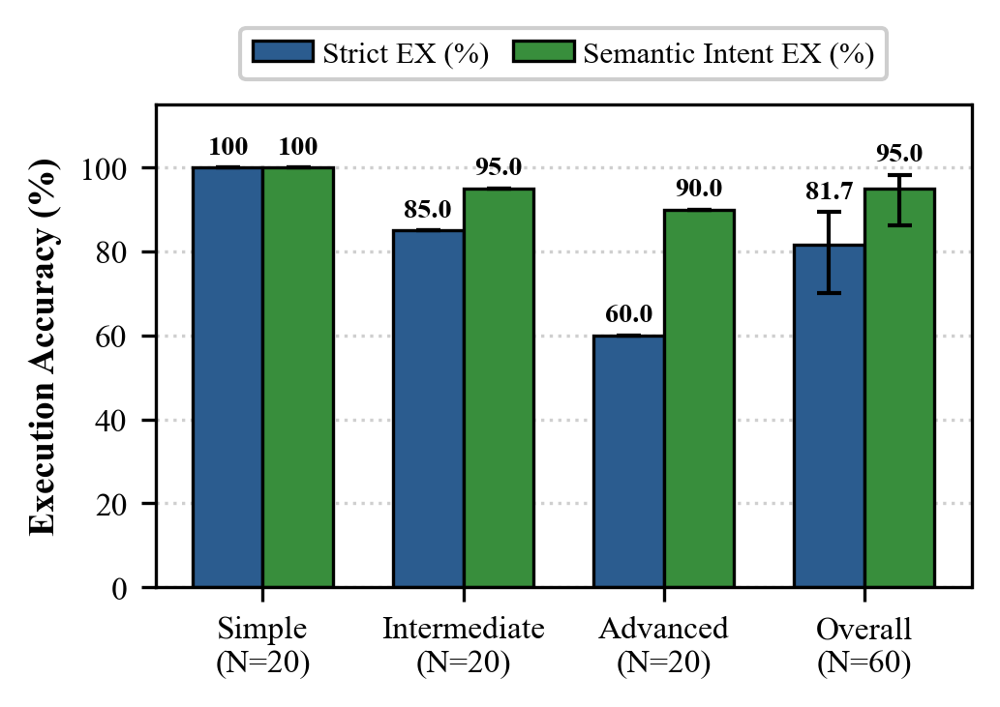
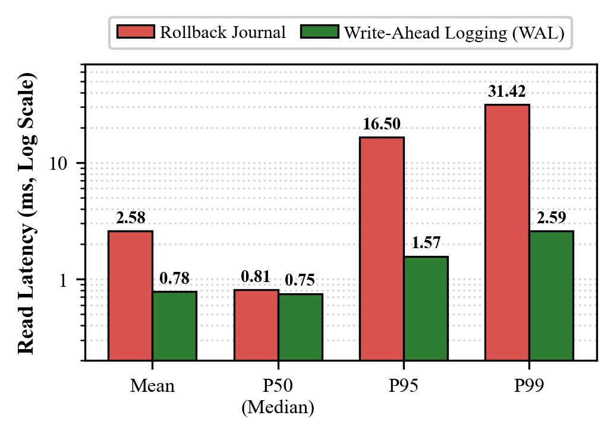

# Edge-Traffic-SQL

**Concurrent Edge Vehicle Tracking and Natural-Language Text-to-SQL Analytics on NVIDIA Jetson**

[](https://www.python.org/downloads/)
[-76B900.svg)](https://developer.nvidia.com/embedded/jetson-orin)
[](LICENSE)

Official repository for the paper:  
> **"Edge-Traffic-SQL: Concurrent Edge Vehicle Tracking and Natural-Language Text-to-SQL Analytics on NVIDIA Jetson"**  
> *Ashraful Islam Semon et al., Chittagong University of Engineering and Technology (CUET)*

---

## Overview

Highways and urban intersections produce vast amounts of video footage. Streaming high-resolution feeds to central clouds incurs substantial network bandwidth costs and raises privacy concerns regarding vehicle license plates and passenger identities. 

**Edge-Traffic-SQL** addresses these challenges by executing real-time multi-object vehicle tracking and an on-device natural-language query interface concurrently on an energy-efficient **NVIDIA Jetson Orin Nano (8 GB)**:

1. **Track 1 (Continuous Edge Perception):** A frozen YOLO11n detector coupled with ByteTrack extracts per-vehicle trajectory records (vehicle type, dominant colour, travel direction, and kinematic speed estimates) from video feeds.
2. **Decoupled Concurrency Layer:** Ingested metadata is written directly to a local **SQLite database configured in Write-Ahead Logging (WAL) mode**, completely isolating continuous video pipeline writes from concurrent analytical read queries.
3. **Track 2 (On-Device Text-to-SQL Query Engine):** A quantized 4-bit Small Language Model (**Qwen2.5-Coder-3B** running locally via Ollama) translates plain-English operator questions into read-only SQL queries with a short schema prompt (~396 tokens), 5 few-shot demonstrations, an AST-based read-only validation sandbox, and a single-retry repair loop.

<p align="center">
  
  
</p>

---

## Key Experimental Results

* **Dual-Track Real-Time Performance:** YOLO11n compiled with TensorRT FP16 achieves **35.2 FPS** standalone and maintains **24.6 FPS** during concurrent active LLM query generation.
* **Text-to-SQL Accuracy (60-Query Benchmark):**
  * **100% Valid SQL Rate (VSR)** (60/60 syntactically executable queries).
  * **81.67% Strict Execution Accuracy** (49/60 exact ground-truth row matches; 95% Wilson CI: 70.08% – 89.44%).
  * **95.00% Semantic Intent Accuracy** (57/60 verified correct semantic results).
  * **1.81 s** average warm generation latency on Jetson Orin Nano.
* **Memory Footprint:** Peak unified memory usage remains at **4.71 GB** (well within the 7.4 GB usable ceiling of the 8 GB Jetson Orin Nano).
* **Storage Reduction:** Extracted metadata consumes **1.57 MB/hour** of video (a 700×–1,150× reduction compared to raw 1080p H.264 video streams).
* **Lock-Free Concurrency:** SQLite WAL mode reduces 99th-percentile read query latency from **31.42 ms to 2.59 ms** and accelerates continuous write transactions by **8.6×** with zero lockouts.

---

## Repository Structure

```text
Edge-Traffic-SQL/
├── config/
│   └── pipeline_jetson.yaml             # Track 1 video pipeline & tracker configuration
├── track1_video_pipeline.py             # Track 1: YOLO11n + ByteTrack + SQLite ingestion
├── track2_query_engine/
│   ├── __init__.py
│   ├── schema.py                        # Minimal token-efficient schema generator (~396 tokens)
│   ├── prompts.py                       # System instructions & 5 disjoint few-shot examples
│   ├── sql_engine.py                    # Read-only SQLite executor & AST safety validator
│   ├── llm_client.py                    # Ollama / OpenAI REST API client with retry logic
│   ├── pipeline.py                      # End-to-end Text-to-SQL translation & execution
│   ├── cli.py                           # Interactive terminal query interface
│   ├── web_ui.py                        # Zero-dependency local browser dashboard (port 8501)
│   ├── evaluate.py                      # Academic benchmark evaluation runner
│   ├── benchmark_queries.json           # 60 curated evaluation queries with ground truth
│   ├── migrate_features.py              # Offline colour & speed metadata enrichment script
│   └── feature_stats.py                 # Summary statistics of database tracks
├── outputs/jetson_tuned/
│   ├── traffic_analytics.sqlite         # Pre-populated evaluation database (14 UA-DETRAC sequences)
│   ├── vehicle_tracks.csv               # Summary tracks metadata (1,868 tracks)
│   └── storage_contention_benchmark.json# Concurrency benchmark metrics
├── benchmark_reports/                   # Benchmark execution reports & logs
├── docs/                                # Publication figures & assets
├── generate_fig4.py                     # Script to reproduce Figure 3 (Accuracy by Tier)
├── generate_fig5.py                     # Script to reproduce Figure 4 (WAL vs Rollback Latency)
├── benchmark_storage_contention.py      # Storage concurrency stress-test harness
├── JETSON_TRANSFER_GUIDE.md             # Step-by-step NVIDIA Jetson Orin Nano deployment guide
├── requirements.txt                     # Python dependencies
├── LICENSE                              # MIT License
└── README.md
```

---

## Quickstart

### 1. Installation

Clone this repository and install Python requirements:

```bash
git clone https://github.com/semon87/Edge-Traffic-SQL.git
cd Edge-Traffic-SQL
pip install -r requirements.txt
```

### 2. Set Up Ollama & Download LLM Weights

Install [Ollama](https://ollama.com/) on your host or Jetson device and pull the evaluated 3B model:

```bash
# Pull Qwen2.5-Coder 3B (Q4_K_M quantization, ~2.1 GB)
ollama pull qwen2.5-coder:3b
```

*(Optional: For ultra-compact 4GB edge devices, `ollama pull qwen2.5-coder:1.5b` can be used instead).*

---

## Running Edge-Traffic-SQL

### Interactive Web Dashboard

Launch the zero-dependency embedded web interface:

```bash
python -m track2_query_engine.web_ui --port 8501
```
Open `http://localhost:8501` (or `http://<jetson-ip>:8501`) in your browser to inspect database statistics and query traffic data using natural language.

### Interactive CLI

```bash
python -m track2_query_engine.cli --provider ollama --model qwen2.5-coder:3b
```

*Example Queries:*
* `"Show all blue buses that moved right today between 10 AM and 11 AM."`
* `"How many speeding vehicles were recorded today?"`
* `"List the top 5 fastest trucks and their recorded speeds."`

---

## Reproducing Paper Benchmarks

### 1. Verify 60-Query Ground Truth

Verify all 60 ground-truth SQL queries against the included evaluation database (`traffic_analytics.sqlite`):

```bash
python -m track2_query_engine.evaluate --verify-gt
```

### 2. Run Full Text-to-SQL Evaluation

Evaluate `Qwen2.5-Coder-3B` against the 60 benchmark queries:

```bash
python -m track2_query_engine.evaluate --provider ollama --model qwen2.5-coder:3b
```
Detailed performance reports will be saved to `benchmark_reports/benchmark_results.csv` and `benchmark_reports/benchmark_summary.json`.

### 3. Run Storage Contention Benchmark

Benchmark SQLite Rollback Journaling vs. Write-Ahead Logging (WAL) under concurrent video ingestion and query load:

```bash
python benchmark_storage_contention.py --duration 15 --readers 4 --busy-timeout 100
```

### 4. Regenerate Paper Figures

```bash
python generate_fig4.py  # Generates fig_accuracy_tiers.pdf and fig_accuracy_tiers.png
python generate_fig5.py  # Generates fig_wal_latency.pdf and fig_wal_latency.png
```

---

## Citation

If you use Edge-Traffic-SQL or the query benchmark in your research, please cite our paper:

```bibtex
@inproceedings{semon2026edgetrafficsql,
  title={{Edge-Traffic-SQL: Concurrent Edge Vehicle Tracking and Natural-Language Text-to-SQL Analytics on NVIDIA Jetson}},
  author={Ashraful Islam Semon and Contributors},
  booktitle={IEEE Conference Proceedings},
  year={2026}
}
```

---

## License

This project is licensed under the [MIT License](LICENSE).

